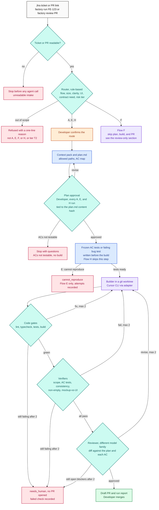
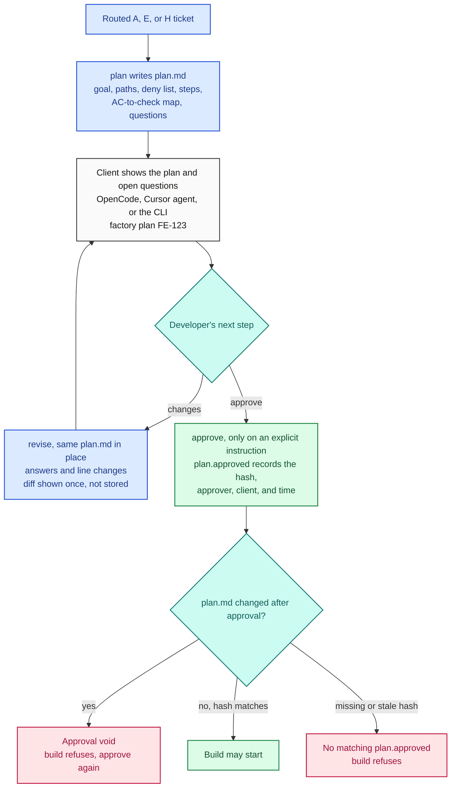
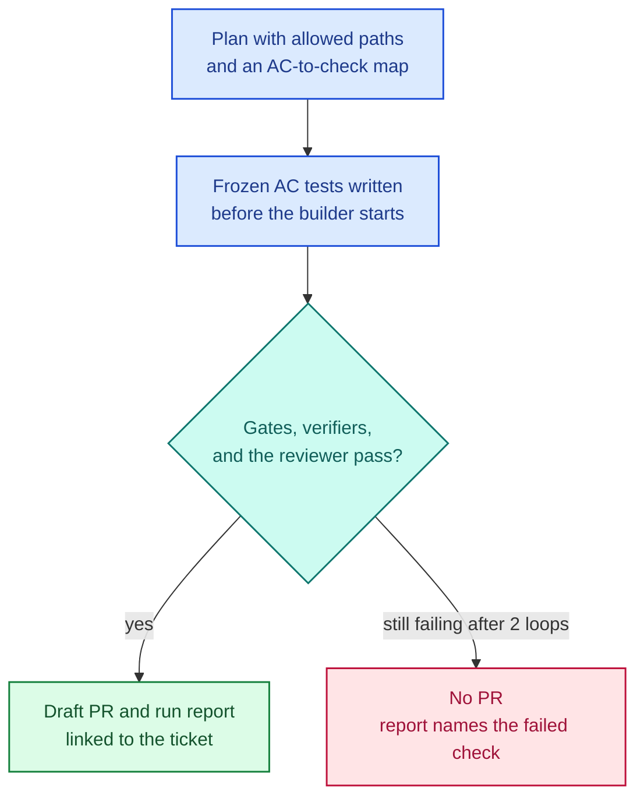
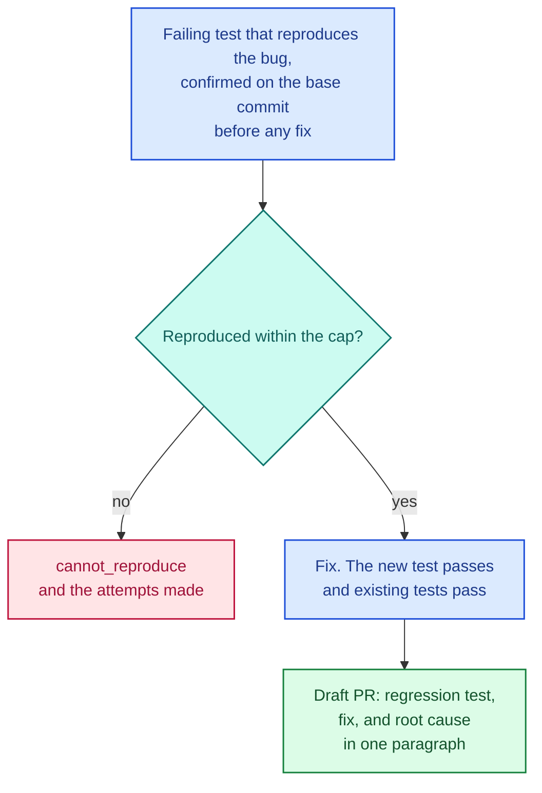
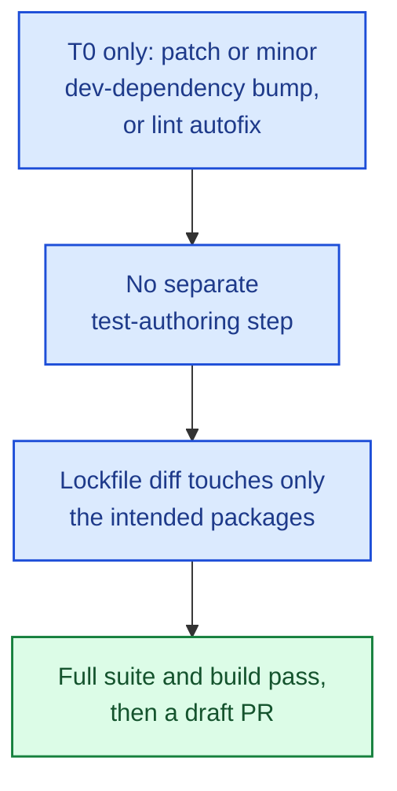
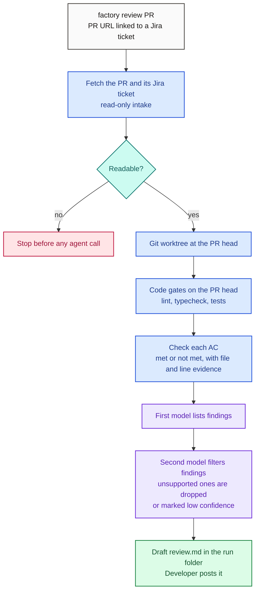
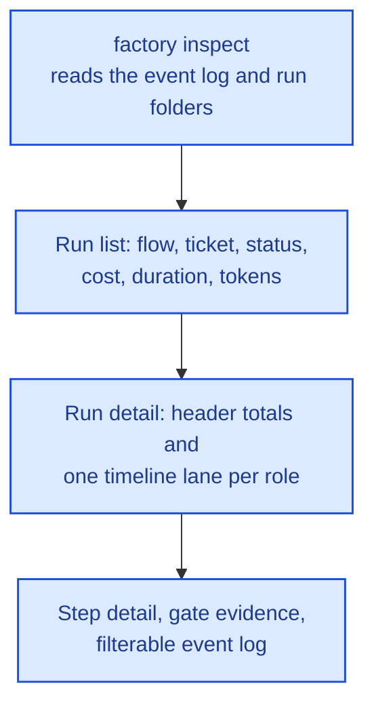
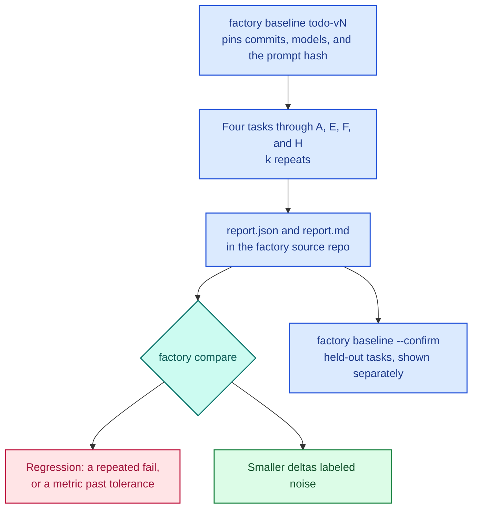

# End-to-end flow

This is the MVP flow from the product requirements (draft v0.1, 14 November 2026). This repository does not contain the CLI, the run folders, or the inspector. Commands and paths below are the ones in those requirements.

1. [Overview](#overview)
2. [Actors and components](#actors-and-components)
3. [Entry points](#entry-points)
4. [Routing](#routing)
5. [Plan and approval](#plan-and-approval)
6. [Build and verify](#build-and-verify)
7. [Outputs](#outputs)
8. [Flow F (review only)](#flow-f-review-only)
9. [Stop conditions](#stop-conditions)
10. [Run folders and inspect](#run-folders-and-inspect)
11. [Measuring the factory](#measuring-the-factory)
12. [Glossary](#glossary)

<a id="overview"></a>

## 1. Overview

A local CLI takes one Jira ticket or one teammate pull request and returns a draft PR or a draft review, plus a run report. The Developer approves the plan and merges.

Pipeline control is ordinary code. The requirements describe that code as TypeScript or Python. Agents do work only inside a single step, through one swappable CLI adapter.

The factory never merges, never approves, never posts review comments, and never writes to Jira.

| Does | Does not |
| --- | --- |
| Turn T0/T1 small stories, bugs, and limited chores into draft PRs with a run report | Merge, approve, post review comments, or write to Jira |
| Draft acceptance-criteria reviews of teammates' PRs for the Developer to post | Auto-merge at any tier |
| Record cost, time, gate results, and human minutes for every run | Large-story splitting, parallel swarms, or multi-repo builds |
| Enforce gates, verifiers, write scope, and caps in code | Mockup creation, or API-contract work |
| Call every worker through a CLI (`agent`, `opencode`, Copilot CLI) | A vendor SDK or API as a worker |
| Prove a factory change with an eval set and canaries | Self-modifying prompts or skills with no eval gate |

MVP flows are A (small clear story), E (bug or regression), F (review a teammate's PR), and H (limited chores). The router refuses everything else.



Colors, when the renderer keeps them: orange is the Developer, blue is factory code, purple is an agent step, teal is a decision, green is a successful output, red is a stop.

A per-run dollar, turn, and wall-clock cap is enforced across the whole run. It is not a node on the diagram. When a cap is hit the run stops, keeps the worktree, and reports `exit_reason: budget` or `timeout`.

<a id="actors-and-components"></a>

## 2. Actors and components

| Piece | Role |
| --- | --- |
| Developer | Confirms the route, approves the plan, posts reviews, and merges. |
| CLI | The `factory` commands. Every client calls the same core entry point. The core has no client-specific path. |
| Router | Rules on labels, paths, and text. Classifies flow, size, clarity, UI involvement, contract need, and risk tier. |
| Planner | Writes one `plan.md` from a context pack. |
| Builder | Edits code in a git worktree through the CLI adapter. |
| Verifiers | Code checks: plan conformance, frozen AC tests, verdict consistency, non-empty checks, write scope, and mockup-vs-UI. |
| Reviewer | A different model family from the builder. Checks the diff against the plan and each acceptance criterion, with file and line evidence. |
| Inspect UI | Read-only page on localhost over the event log and run folders. |

Every agent call goes through `WorkerRuntime.run` (prompt, working directory, allowed paths, model, budget, session id, schema). The call returns a result, cost, tokens, events, and an exit reason. Each adapter wraps a CLI process. Inputs are flags and a prompt. Output is parsed from the CLI's JSON or text stream. Cost and tokens are taken from the CLI when it reports them, and estimated and flagged when it does not. A wall-clock timeout kills the process tree.

Cursor `agent` is the primary runtime. `opencode` and Copilot CLI are adapters on the same contract. Claude Code is an optional fallback adapter. The Cursor SDK and API are out of the MVP. Exact output fields per CLI are still to be verified.

Models are set per role in config, not in pipeline code. Builder and reviewer use different model families. No role uses a "high fast" model variant.

<a id="entry-points"></a>

## 3. Entry points

A run starts from a manual command. There is no polling and no webhook.

| Command | What it starts |
| --- | --- |
| `factory run <ticket>` | One Jira key. Example: `factory run FE-123`. Flows A, E, and H. |
| `factory review <PR>` | One teammate pull request. Flow F. |
| `factory inspect` | The read-only localhost inspector. |

Jira is read with `acli` or REST, and that access is read-only. GitHub access is `gh`, used to open draft PRs and to fetch a PR for review.

Runs execute on the Developer's machine, in git worktrees. One run at a time, or two in parallel when their paths do not overlap.

An agent client calls the same entry point as the CLI. OpenCode is one such client, covered by a one-time smoke test. It is not a separate surface.

Commands that continue a run, or that exist only for developing the factory, are in [Plan and approval](#plan-and-approval), [Run folders and inspect](#run-folders-and-inspect), and [Measuring the factory](#measuring-the-factory).

<a id="routing"></a>

## 4. Routing

The router records the route and the rule that chose it. The Developer confirms the route before work starts.

| Flow | MVP | What it is |
| --- | --- | --- |
| A | In | Small clear story, T0 or T1, with testable acceptance criteria |
| E | In | Bug or regression. A failing reproduction test comes before the fix |
| F | In | Review a teammate's PR. Read-only |
| H | Limited | T0 chores only: a patch or minor dev-dependency bump, or a lint autofix. Existing tests are the spec |
| B | Later | Large story split into parallel worktrees |
| C | Later | Refinement, a grilling round, FigCraft mockups, and an approval wait. Grilling stays manual |
| D | Later | API contract with a backend. Always T2 |
| G | Later | Spike or prototype |

| Tier | How the requirements use it |
| --- | --- |
| T0 | Lowest tier. Flow H runs only when the router classifies the chore as T0 |
| T1 | Together with T0, the small stories flow A can accept |
| T2 | Unknown tier, or work the MVP refuses. Unknown tier means T2 |

A refusal is one line. The router refuses tier T2 and flows B, C, D, and G. A major version bump, a runtime dependency, or a new package is T2 and is refused.

<a id="plan-and-approval"></a>

## 5. Plan and approval

Flows A, E, and H pause here. Flow F has no plan.

There is one plan per ticket: `~/.factory/runs/<repo>/<ticket>/plan.md`. The planner writes it from a context pack kept in that run's `context/` directory.

The plan holds the goal, allowed paths, deny list, steps, an acceptance-criteria-to-check map, open questions with answers, and assumptions. It is Markdown with a small YAML front matter (ticket, base commit) so code can read the paths and the map.

`revise` and hand edits change that same file in place. No version history is kept. The client shows the diff once, in chat or in CLI output, and does not store it.

| Path | How approval happens |
| --- | --- |
| Agent client, primary | OpenCode or Cursor agent calls `plan`, shows the plan and the open questions, takes answers and line changes, calls `revise` for a few rounds, and calls `approve` only when the Developer explicitly says to |
| CLI, quick path | `factory plan <ticket>`, then `factory revise <ticket> --changes "..."` or a hand edit, then `factory approve <ticket>` |

`factory resume <ticket> --approve` is an alias of approve. `factory resume <ticket> --changes "..."` is an alias of revise.

`plan.approved` stores the content hash of the current `plan.md`, plus the approver, the client, and the time. Any later change to `plan.md` voids that approval. The build refuses when no `plan.approved` matches the current hash, and it asks for approval again.



The last decision is the check the build performs: the stored hash must match the file on disk.

<a id="build-and-verify"></a>

## 6. Build and verify

After approval, tests are written before the builder starts. Flow H skips that step.

| Flow | Before the builder starts |
| --- | --- |
| A | Frozen acceptance-criteria tests exist. The builder cannot edit them |
| E | A failing test that reproduces the bug is confirmed on the base commit. If it cannot be reproduced within the cap, the run stops as `cannot_reproduce` and records the attempts. The reproduction file is not modified after that confirmation |
| H | No separate test-authoring step. Existing tests are the spec |

The builder works in one git worktree per run, from a pinned base commit, through the CLI adapter. The Developer's working copy is never modified. The worktree path and the base commit are in the run report.

Code gates are lint, typecheck, unit tests, and build. They are commands, judged by exit code. The requirements assume the repo already has those commands. Failures go back to the builder verbatim.

| Verifier | Rule stated in the requirements |
| --- | --- |
| Plan conformance | Allowed paths and the deny list |
| Frozen AC tests | Hidden tests the builder cannot edit |
| Verdict consistency | Named. No separate rule is stated |
| Non-empty | A check that looked at zero items fails |
| Write scope | Revert-aware. An edit to a protected path aborts the run as a breach: frozen tests, verifier code, CI, `.env`, and lockfiles unless they are allowed |
| Mockup-vs-UI | For a UI ticket with an approved mockup (for example exported from FigCraft, attached to the ticket, or linked from `plan.md`). The verifier renders the view in the worktree, takes a Playwright screenshot at the mockup's viewport, and compares the two. Evidence (both images, a diff overlay, differing regions with notes) is saved in `verify/`. A ticket with no approved mockup skips this check and the report says so |

The comparison uses a vision-capable model. The exact comparison method is still an open question in the requirements.

The reviewer runs on a different model family. It checks the diff against the plan and each acceptance criterion, with file and line evidence. Code rejects an approval that leaves a blocking item or an unmet criterion.

Gate failures, verifier failures (including a mockup miss), and reviewer revisions each return to the builder at most twice. After that the run stops as `needs_human` and no PR is opened. The report says which check failed and why.

For a flow E fix, the new test passes, existing tests pass, and the reproduction file is unchanged since it was confirmed failing.

For a flow H change, the lockfile diff touches only the intended packages, and the full suite and build pass.



Flow A, inside the shared pipeline. The builder cannot edit the frozen tests.



Flow E, the bug-specific steps. Gates, verifiers, and the reviewer still run as in the overview.



Flow H, the chore-specific steps. Plan approval still happens. A major bump, a runtime dependency, or a new package is refused at routing as T2.

<a id="outputs"></a>

## 7. Outputs

A draft PR opens only when the gates, the verifiers, and the reviewer pass.

| Output | What the Developer gets |
| --- | --- |
| Pull request | Draft. It links the ticket and includes the run report. The factory never merges, never approves, and never pushes to other branches |
| Merge | The Developer's. Every merge in the MVP is a human merge |
| Flow E | The PR contains the regression test, the fix, and the root cause in one paragraph |
| UI screenshots | The PR description shows the key images from `verify/` |
| Run report | Route, plan, acceptance criteria and their checks, gate results, fix loops, model per role, tokens, cost, duration, and human gates |

Code stays in the worktree and on the draft PR branch. It is not copied into the run folder.

If a required artifact is missing, the report marks it missing and the run cannot end as `passed`.

<a id="flow-f-review-only"></a>

## 8. Flow F (review only)

`factory review <PR>` takes a pull request URL linked to a Jira ticket. It skips the plan, the build, and PR creation. It reuses the reviewer and the acceptance-criteria checks.



The draft lists each acceptance criterion as met or not met, with file and line evidence, and includes the lint, typecheck, and test results from the PR head. A second model drops findings it cannot support, or marks them low confidence.

The result is `review.md` in the run folder. Nothing is posted, approved, or pushed. The Developer posts the review.

<a id="stop-conditions"></a>

## 9. Stop conditions

| Condition | Result |
| --- | --- |
| Ticket or PR cannot be read | Stop before any agent call |
| Not flow A, E, F, or H, or tier T2 | Refused, with a one-line reason |
| Acceptance criteria are not testable | Stop with the questions to ask. No build |
| Flow E cannot reproduce the bug within the cap | Status `cannot_reproduce`, with the attempts made |
| A gate, verifier, or review is still failing after 2 loops | Status `needs_human`. No PR. The report names the failed check and why |
| Edit to a protected path | Abort as a breach |
| Dollar, turn, or wall-clock cap | Stop, keep the worktree, `exit_reason: budget` or `timeout` |
| `plan.md` hash missing or stale | The build refuses and asks for approval again |

Recommended per-run caps, still open questions and still estimates: flow A $5 and 30 minutes, E $6 and 45 minutes, F $2 and 15 minutes, H $2 and 15 minutes.

<a id="run-folders-and-inspect"></a>

## 10. Run folders and inspect

The factory home is `~/.factory/`, outside every repo. Each work repo holds only committed config.

```text
~/.factory/
  factory.db                          # SQLite event log
  worktrees/<repo>/<ticket>/          # git worktree for the run
  runs/<repo>/<ticket>/
    ticket.json                       # Jira snapshot: title, description, ACs, labels, links
    plan.md                           # the one plan
    plan.approved                     # hash, approver, client, time
    context/                          # context pack the planner used
    decisions.md
    evidence/diff.patch
    evidence/gates/                   # command output
    verify/                           # Playwright screenshots
    report.md                         # run report
    review.md                         # flow F only

<work-repo>/
  .factory/config.yaml                # protected paths, gate commands, flow caps
  AGENTS.md                           # project rules for every runtime
```

Project skills live in `SKILL.md`, readable by any runtime. Nothing from a run is committed. `git log` and `git status` in the work repo show no factory artifacts outside the draft PR branch and `.factory/config.yaml`.

Every event is a row in `factory.db` with run id, role, model, step, start, end, cost, tokens in, tokens out, and status. Gate events include the evidence: what was checked, the inputs, and the result. An event missing a required field fails that run's schema check.

`factory clean` applies two fixed rules. A worktree is removed more than 7 days after its pull request merged or the run was abandoned. `ticket.json`, `prompts/` and `evidence/` are deleted more than 30 days after the run ended (`ended_at`). `report.md`, `plan.md` and the event rows are kept. It takes no `--older-than` flag, and nothing runs it on a schedule: it applies the rules when you run it.

`factory inspect` serves a read-only UI on localhost. It reads the event log and the run folders. It has no control that changes a run, a file, a PR, or Jira, and it is not reachable from other machines.



| View | What it shows |
| --- | --- |
| Run list | Cards with flow, ticket or PR, request summary, a per-role lane strip, status, cost, duration, and tokens. Newest first. Filter by flow and status |
| Run detail | Header totals (cost, duration, tokens in and out, fix loops) equal the sum of the steps. One swimlane per role: router, planner, builder, gates, verifiers, reviewer. Each step shows its model and timing |
| Step | Prompt or request, plan, outputs (diff summary, files, review findings), cost, time, and tokens |
| Gate evidence | Result, and what it looked at: command and exit code, files and paths, the AC-to-test map, item counts. A gate with zero checked items is shown as failed |
| Event log | Timestamped events, filterable by role and step |
| Bad events | Missing or malformed fields are named. The page stays up |

Live streaming, a context-window percentage, side-by-side run comparison, and approve or stop buttons are later. They are not in the MVP inspector. In dev mode the inspector can also show baseline reports, read-only. See the next section.

<a id="measuring-the-factory"></a>

## 11. Measuring the factory

`factory baseline` and `factory compare` are dev-only. They are not user-facing commands. They are never installed into a work repo and never run on one. They complement an eval set of past pull requests. They do not replace it.

The sample is a fixed to-do app in its own repo: TypeScript, React, Vitest, Testing Library, and Playwright for a few end-to-end checks. Each version is an immutable git tag (`todo-v0`, `todo-v1`, …) with a start state, one story for the new feature, hidden acceptance tests kept outside the agent worktree, and a written expected outcome. Tags are never moved. Changing the hidden tests means a new tag. The ladder order is a suggestion.

| Version | Adds | What it stresses | MVP |
| --- | --- | --- | --- |
| v0 | Add, complete, delete, list, with unit tests | The pipeline runs end to end | In |
| v1 | Filters with URL state (all, active, done survive reload and the back button) | State kept in sync in two places | In |
| v2 | Optimistic updates with rollback on a mocked API failure | Async state and error paths | In |
| v3–v6 | Drag-and-drop, offline queue, i18n, accessibility focus | Later. Harder features wait until v2 passes | Later |

`factory baseline todo-v1` runs four tasks through the same entry point as a normal run: a feature (flow A), a bug with a known reproduction (E), a seeded PR with planted defects (F), and a chore (H). It pins and records the base commit, sample version, factory version, runtime, model ids, and a hash of the prompts and skills. An unpinned input fails before any agent call.

The decided baseline runtime is the Cursor `agent` CLI with the configured builder and reviewer models. Other CLIs are separate, labeled reports.

A sample version passes for a factory version only when every task meets its expected outcome in all k repeats (pass^k, default k = 3, an estimate): hidden tests pass, gates are green, the review catches every planted defect with no false approve, and the per-task cost cap holds. One failed repeat marks the version not passed, and names the task, the criterion, and the repeat.

Reports are written to `baseline-reports/<sample-version>/<factory-version>/report.json` and `report.md` in the factory source repo, with a `schema_version` field. They are never written to `~/.factory/` or to a work repo.

`factory compare <reportA> <reportB>` prints per-metric deltas. A task or criterion that went from pass to fail is flagged when it repeats often enough to count: a pass-to-fail in at least 2 of 3 repeats (the default, an estimate), or a metric past tolerance. Smaller deltas are labeled noise. Reports with different `schema_version` values are refused.

Recommended noise tolerances, still open questions and still estimates: cost or tokens more than 15% worse, duration more than 20% worse, hidden-test pass rate down by more than 2 points.

For each flagged regression, compare links the run ids, the failing step, the transcript path, and the gate evidence from both reports. Each link opens an existing file.

`factory baseline todo-v2 --confirm` runs hidden held-out tasks and lists tuning-set and held-out pass rates in separate fields. A normal tuning run never reads or runs the held-out tasks.

From `todo-v2` on, one UI task has an approved mockup and a planted visual difference. The mockup-vs-UI verifier must catch it, and the catch counts as a canary.

The grader, hidden tests, held-out tasks, planted defect lists, mockup differences, and canaries stay outside the agent worktree and are never passed to an agent.

Separately, every factory change replays an eval set of past tickets and runs gate canaries. A change is accepted only if the eval pass rate does not drop and every canary is caught.



<a id="glossary"></a>

## 12. Glossary

| Letter | MVP | Meaning |
| --- | --- | --- |
| A | In | Small clear story, T0 or T1, with testable acceptance criteria |
| E | In | Bug or regression. Failing reproduction test before the fix |
| F | In | Review a teammate's PR. Read-only. Local `review.md` |
| H | Limited | T0 chore: patch or minor dev-dependency bump, or lint autofix |
| B | Later | Large story split into parallel worktrees |
| C | Later | Refinement, grilling, FigCraft mockups, approval wait |
| D | Later | API contract with a backend. Always T2 |
| G | Later | Spike or prototype |

| Tier | Meaning |
| --- | --- |
| T0 | Lowest tier. Flow H runs only when the chore is classified T0 |
| T1 | With T0, a small clear story that flow A can accept |
| T2 | Unknown tier, or out of the MVP. Refused with a one-line reason |

| Term | Meaning |
| --- | --- |
| Developer | The person who confirms the route, approves the plan, posts the review, and merges |
| AC | An acceptance criterion on the Jira ticket |
| Context pack | The material the planner used, stored under `context/` |
| `plan.md` | The one plan for a ticket. Revisions edit it in place |
| `plan.approved` | The content hash of that plan, with approver, client, and time. An edit voids it |
| Worktree | One git checkout per run, from a pinned base commit. The working copy stays untouched |
| CLI adapter | A `WorkerRuntime.run` wrapper around `agent`, `opencode`, or Copilot CLI |
| Code gate | Lint, typecheck, unit tests, or build, judged by exit code |
| Verifier | A code check after the gates. See [Build and verify](#build-and-verify) |
| Reviewer | Checks the diff on a different model family from the builder |
| Fix loop | One return to the builder after a failed gate, verifier, or review. The cap is 2 |
| `needs_human` | Stop after the loop cap. No draft PR |
| `cannot_reproduce` | Flow E stop when the bug is not reproduced within the cap |
| `exit_reason` | `budget` or `timeout` when a per-run cap is hit. The worktree is kept |
| Draft PR | A pull request the factory opens and the Developer merges |
| Run report | `report.md`: route, plan, checks, cost, and time |
| `review.md` | The flow F draft. The Developer posts it |
| Factory home | `~/.factory/`, outside every work repo. Holds the database, worktrees, and runs |
| Baseline | A dev-only run of a tagged to-do sample. Never on a work repo |
| pass^k | Every one of k repeats must pass. Default k is 3, an estimate |
| Canary | A known-bad fixture that its gate must catch |
| Held-out task | A hidden task used only to confirm a factory change, never while tuning |
